# OCTOMATION
## Documentación integral del proyecto CAPSTONE

**Tipo de proyecto:** Plataforma modular de automatización empresarial  
**Arquitectura:** SaaS + microservicios + cliente de escritorio + motor de plugins  
**Backend:** NestJS, FastAPI  
**Frontend:** React  
**Cliente de escritorio:** Electron  
**Lenguajes:** TypeScript, Python  
**Persistencia:** PostgreSQL  
**Infraestructura local:** Docker  
**Gestión de código:** Git, GitHub, Git submodules  
**Distribución de plugins:** GitHub Releases  
**Estado de referencia:** 29 de octubre de 2026

---

# 1. Resumen ejecutivo

Octomation es una plataforma de software orientada a facilitar la administración, distribución y ejecución de automatizaciones empresariales.

Su objetivo es reducir la dependencia de scripts administrados manualmente, centralizar el control de las automatizaciones y permitir que nuevas funcionalidades se distribuyan como plugins independientes.

La arquitectura combina tres grandes elementos:

1. Una plataforma central que administra usuarios, organizaciones, permisos y funcionalidades comerciales.
2. Un conjunto de servicios backend especializados que implementan las reglas de negocio.
3. Un cliente de escritorio que ejecuta automatizaciones localmente mediante un motor desarrollado en Python.

La plataforma contempla una arquitectura multiempresa, en la que distintas organizaciones pueden utilizar el sistema manteniendo separados sus recursos y permisos.

Uno de los principales elementos diferenciadores es el sistema de plugins. Las automatizaciones se diseñan como componentes independientes que pueden descubrirse, instalarse, actualizarse y ejecutarse sin tener que incorporar cada funcionalidad directamente al núcleo de la aplicación.

La visión de evolución consiste en avanzar hacia un entorno en el que usuarios no técnicos puedan administrar y, potencialmente, construir automatizaciones mediante interfaces visuales.

## 1.1. Propuesta de valor

Octomation busca proporcionar:

- Administración centralizada de automatizaciones.
- Distribución de funcionalidades mediante plugins.
- Ejecución local de procesos Python.
- Separación de responsabilidades mediante servicios backend.
- Gestión de usuarios, organizaciones y permisos.
- Control de versiones y actualizaciones de plugins.
- Una arquitectura extensible para nuevas funcionalidades.
- Una base técnica para construir automatizaciones visuales.

## 1.2. Problema que resuelve

Las empresas suelen depender de scripts, macros, archivos Excel, consultas SQL, tareas programadas y herramientas desarrolladas de manera aislada.

Esto puede generar:

- Dependencia de las personas que desarrollaron los procesos.
- Dificultad para distribuir automatizaciones.
- Instalaciones inconsistentes entre computadores.
- Actualizaciones manuales.
- Falta de trazabilidad.
- Dificultad para administrar permisos.
- Costos de mantenimiento elevados.
- Reutilización limitada de soluciones entre equipos.

Octomation busca proporcionar una infraestructura común para administrar estas automatizaciones.

---

# 2. Mapa mental general de Octomation

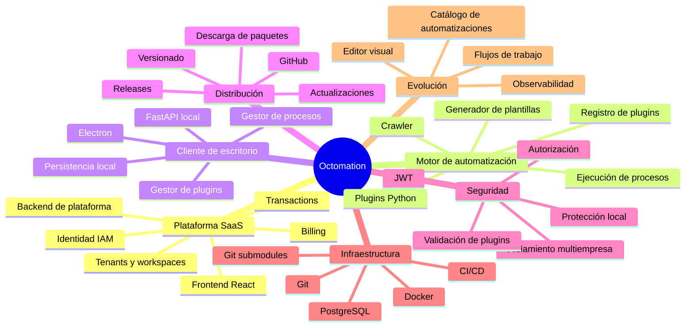

---

# 3. Arquitectura general

Octomation separa las responsabilidades de administración central y ejecución local.

La plataforma remota administra la identidad, los recursos organizacionales y las funcionalidades comerciales. El cliente de escritorio proporciona el entorno de ejecución de las automatizaciones.

Esta separación permite que los scripts se ejecuten en el computador del usuario sin que todos los procesos tengan que ejecutarse en la infraestructura remota.

## 3.1. Diagrama general de arquitectura

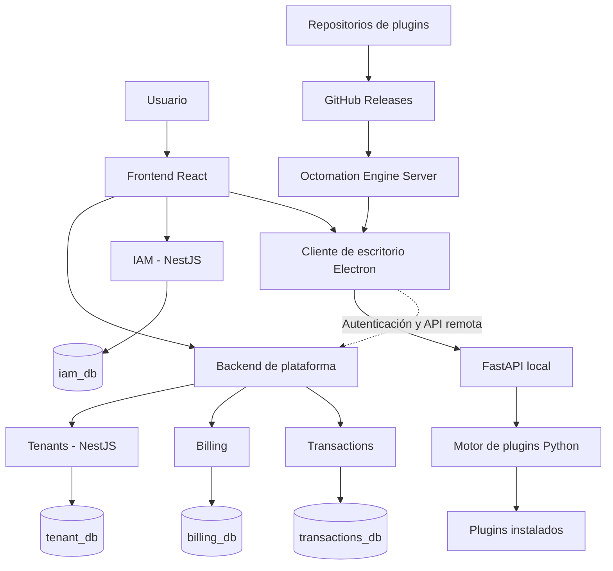

**Nota:** el diagrama representa las responsabilidades conceptuales. Las conexiones efectivas entre servicios, el flujo exacto de autenticación y la implementación del catálogo deben verificarse en el código de cada repositorio.

## 3.2. Principios arquitectónicos

### Separación de responsabilidades

Cada componente debe tener una función bien definida.

### Modularidad

Las funcionalidades deben poder evolucionar sin exigir modificaciones innecesarias en todo el sistema.

### Extensibilidad

El sistema de plugins permite incorporar nuevas automatizaciones mediante componentes independientes.

### Aislamiento

Los recursos de distintas organizaciones deben mantenerse separados mediante controles de autorización y validaciones de pertenencia.

### Ejecución local

El cliente de escritorio permite ejecutar procesos en el computador del usuario.

### Administración centralizada

La plataforma puede centralizar identidad, permisos, distribución y administración de recursos.

### Reproducibilidad

Las plantillas, las versiones de código y los procesos de construcción deben permitir instalaciones consistentes.

---

# 4. Frontend de la plataforma

El frontend constituye el punto de entrada para los usuarios.

Está orientado a proporcionar una interfaz para interactuar con las capacidades que exponen los servicios backend.

## 4.1. Responsabilidades

- Inicio y cierre de sesión.
- Administración de la cuenta.
- Selección de organización o workspace.
- Visualización de recursos disponibles.
- Gestión de usuarios, cuando corresponda.
- Acceso a las funcionalidades autorizadas.
- Consulta de información comercial.
- Administración de automatizaciones.
- Visualización de resultados y estados de ejecución, si se implementa la integración correspondiente.

## 4.2. Principio de seguridad

El frontend no debe ser la autoridad definitiva para determinar si un usuario puede ejecutar una operación.

Puede ocultar botones o mostrar únicamente las funcionalidades disponibles, pero los servicios backend deben validar los permisos de cada operación protegida.

## 4.3. Flujo conceptual

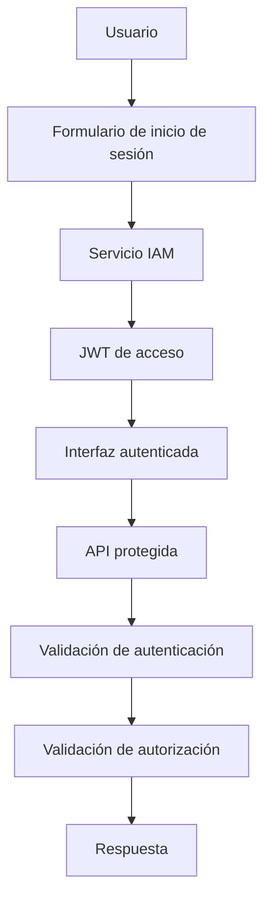

---

# 5. IAM: Identity and Access Management

IAM es el componente encargado de administrar la identidad y el acceso.

En el proyecto se utiliza NestJS para implementar funcionalidades de autenticación y autorización.

## 5.1. Responsabilidades

- Identificar usuarios.
- Validar credenciales.
- Emitir tokens JWT.
- Gestionar roles.
- Gestionar permisos.
- Proteger endpoints.
- Proporcionar información de identidad.
- Aplicar controles de acceso según el modelo implementado.

## 5.2. Flujo de autenticación

1. El cliente envía las credenciales.
2. IAM valida las credenciales.
3. IAM genera un token de acceso.
4. El cliente recibe el JWT.
5. El cliente envía el token en las solicitudes protegidas.
6. El backend valida la firma, vigencia y claims relevantes.
7. El servicio aplica las reglas de autorización.

Ejemplo ilustrativo de respuesta:

```json
{
  "access_token": "TOKEN_JWT",
  "token_type": "Bearer"
}
```

La respuesta real depende del contrato implementado por el endpoint de login.

## 5.3. JWT

Un JSON Web Token puede transportar información como:

- `sub`: identificador del sujeto autenticado.
- `userId`: identificador del usuario, si se incluye.
- `iat`: instante de emisión.
- `exp`: instante de expiración.
- Roles o permisos, si el diseño los incorpora.

No todos estos campos tienen que estar presentes. Se debe revisar el payload real del token.

Un JWT firmado no equivale a un mensaje cifrado. Su contenido puede ser legible, por lo que no deben incorporarse contraseñas ni secretos.

## 5.4. Autenticación frente a autorización

**Autenticación:** determina quién es el usuario.

**Autorización:** determina qué acciones puede realizar.

Un token válido no implica que el usuario tenga permiso para consultar todos los recursos.

La autorización debe considerar el contexto de la operación, incluidos los permisos y la pertenencia a la organización correspondiente.

---

# 6. Tenants y workspaces

El servicio de tenants proporciona el modelo organizacional de la plataforma.

Permite estructurar la participación de usuarios dentro de organizaciones y espacios de trabajo.

## 6.1. Conceptos

- Tenant: contexto organizacional.
- Workspace: espacio de trabajo dentro del modelo organizacional.
- Membership: relación entre un usuario y una organización o espacio.
- Invitation: mecanismo para invitar usuarios.
- Role: conjunto de capacidades asociadas a un usuario.
- Permission: autorización específica para una operación.

La estructura exacta depende de los esquemas y relaciones definidos en el servicio.

## 6.2. Objetivo multiempresa

Cada organización debe acceder únicamente a los datos y recursos que le corresponden.

Por ejemplo, una empresa no debe poder consultar los plugins privados, configuraciones o resultados de otra empresa si no tiene autorización.

## 6.3. Controles necesarios

- Validar la identidad del usuario.
- Comprobar su pertenencia al tenant.
- Comprobar su pertenencia al workspace, cuando corresponda.
- Validar el permiso requerido.
- Aplicar filtros por organización en las consultas.
- Evitar confiar en identificadores enviados libremente por el frontend.
- Probar intentos de acceso cruzado entre organizaciones.

## 6.4. Mapa mental de identidad y aislamiento

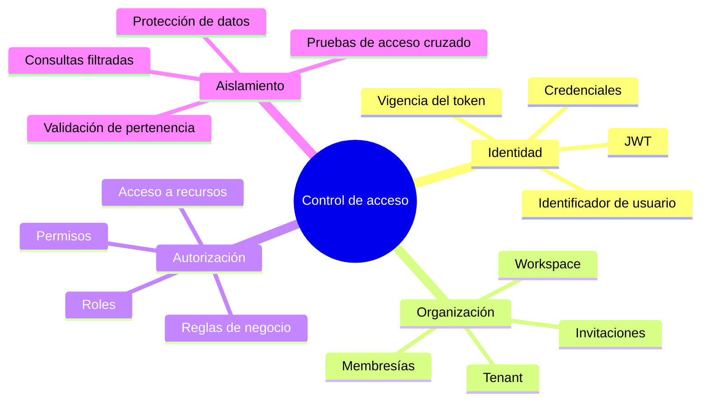

---

# 7. Billing y Transactions

Estos servicios representan la dimensión comercial y transaccional de Octomation.

## 7.1. Billing

El servicio de facturación puede administrar:

- Planes.
- Suscripciones.
- Límites de uso.
- Estados de facturación.
- Relación entre clientes y planes.
- Reglas comerciales.

Las funcionalidades concretas dependen de la implementación actual.

En una evolución SaaS, Billing podría permitir establecer límites sobre usuarios, automatizaciones, ejecuciones o recursos consumidos.

## 7.2. Transactions

El repositorio `OCTO_TRANSACTIONS` contempla el dominio de transacciones.

Entre las entidades trabajadas se encuentran:

- `transactions`
- `payment_attempts`

También se ha considerado la integración con Transbank/Webpay.

La integración de pagos requiere validar los estados de las transacciones, la confirmación del proveedor, los reintentos y la consistencia de los registros.

## 7.3. Separación de responsabilidades

Billing y Transactions no deben confundirse.

Billing administra conceptos comerciales, como planes y suscripciones.

Transactions administra operaciones transaccionales, como pagos e intentos de pago.

Ambos servicios pueden necesitar comunicarse, pero deben mantener contratos claros.

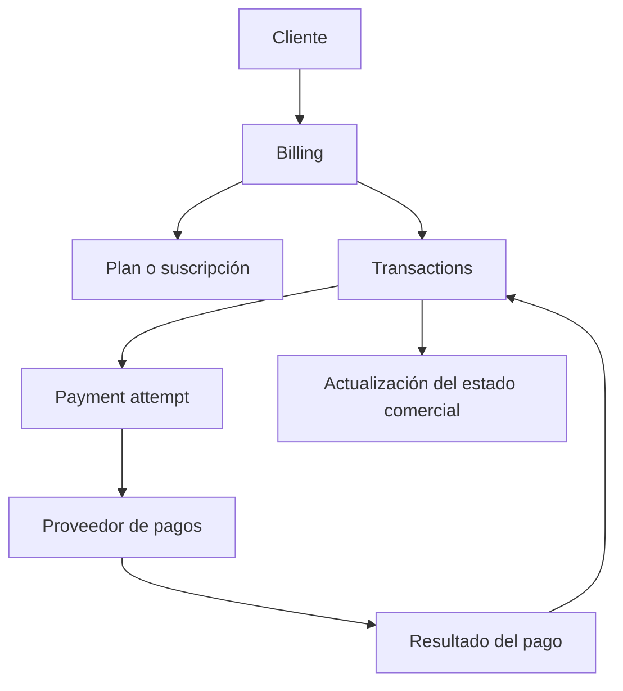

Este flujo representa una integración conceptual y no implica que el procesamiento completo de pagos esté terminado.

---

# 8. Sistema de plugins

El sistema de plugins es uno de los componentes centrales de Octomation.

Permite encapsular funcionalidades independientes y proporcionar una estructura consistente para descubrirlas, administrarlas y ejecutarlas.

## 8.1. Objetivos

- Evitar que todas las automatizaciones estén acopladas al núcleo.
- Facilitar el desarrollo de funcionalidades independientes.
- Establecer una estructura común.
- Facilitar el descubrimiento automático.
- Administrar versiones.
- Permitir la instalación y actualización.
- Separar el motor de ejecución de la lógica de cada automatización.

## 8.2. Estructura conceptual de un plugin

La plantilla trabajada contempla componentes como los siguientes:

```text
plugin/
  metadata
  data/
  pages/
  services/
  static/
  backgroundProcesses/
  dto/
```

La extensión y los nombres exactos de los archivos dependen del generador de plantillas.

### `metadata`

Identifica el plugin y describe sus características.

Entre los campos trabajados se encuentran:

- `plugin_name`
- `category`
- `version`
- `author`
- `email`

También puede ser necesario definir un identificador estable, compatibilidad del motor, dependencias y capacidades.

### `data/`

Contiene datos o recursos propios del plugin.

### `pages/`

Contiene páginas o componentes de interfaz, según las convenciones de la plantilla.

### `services/`

Contiene la lógica de negocio y las operaciones del plugin.

### `static/`

Contiene recursos estáticos.

### `backgroundProcesses/`

Contiene procesos que pueden ejecutarse en segundo plano.

### `dto/`

Contiene objetos de transferencia de datos y estructuras de validación.

## 8.3. Generador de plantillas

El generador de plantillas busca que todos los plugins sigan convenciones compatibles.

Una estructura predecible permite que el crawler y el motor local sepan dónde encontrar los componentes de cada plugin.

El generador debería producir estructuras reproducibles, evitando que cada desarrollador tenga que crear manualmente los directorios y archivos requeridos.

## 8.4. Crawler

El crawler examina el entorno local y busca plugins que cumplan con las convenciones esperadas.

Su función principal es descubrir y registrar los plugins instalados.

Debe diferenciarse entre:

- Descubrir un directorio.
- Validar su estructura.
- Leer sus metadatos.
- Comprobar su compatibilidad.
- Autorizar su ejecución.

Encontrar un plugin no significa que sea seguro ejecutarlo.

## 8.5. Registro de plugins

El registro permite mantener información sobre los plugins identificados.

Puede incluir:

- Identificador.
- Nombre.
- Categoría.
- Autor.
- Versión instalada.
- Estado.
- Ubicación.
- Fecha de instalación.
- Compatibilidad.

Los campos efectivos dependen de la implementación.

## 8.6. Mapa mental del sistema de plugins

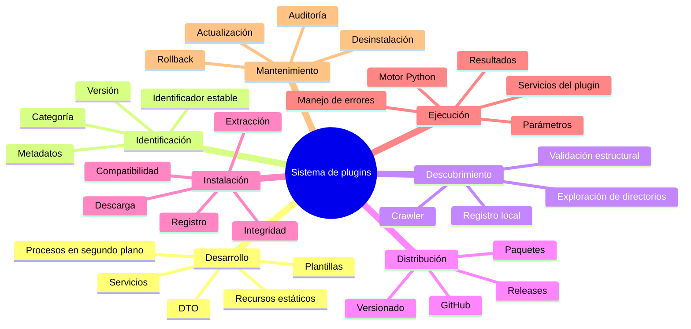

---

# 9. Octomation Engine Server

El repositorio `Octomation-Engine-Server` corresponde al componente central de gestión y distribución de plugins.

Su objetivo es proporcionar información sobre los plugins disponibles y las versiones publicadas.

## 9.1. Responsabilidades previstas

- Consultar metadatos de plugins.
- Identificar versiones disponibles.
- Referenciar repositorios.
- Obtener información de releases.
- Facilitar la descarga de paquetes.
- Proporcionar información al cliente de escritorio.

## 9.2. Información de los plugins

El endpoint desarrollado devuelve información con campos como:

- `pluginId`
- `name`
- `category`
- `author`
- `email`
- `repositoryUrl`
- `latestVersion`
- `releaseTag`
- Timestamps asociados.

La estructura real debe verificarse en el DTO y en el contrato del endpoint.

## 9.3. GitHub Releases

Las releases permiten distribuir versiones empaquetadas de los plugins.

El servidor puede consultar la versión publicada y proporcionar información para que el cliente obtenga el paquete.

Debe definirse claramente cuál es la fuente de verdad para la versión instalada y la versión disponible.

## 9.4. Separación entre catálogo y ejecución

El servidor central no necesita ejecutar todas las automatizaciones.

Su responsabilidad principal es administrar o exponer información de distribución.

El cliente local se encarga del entorno de ejecución.

Esta separación permite que la plataforma administre versiones sin centralizar obligatoriamente todo el procesamiento de los scripts.

---

# 10. Octomation Engine Client

El repositorio `Octomation-Engine-Client` contiene la aplicación de escritorio y el entorno de ejecución local.

La arquitectura trabajada combina Electron, React y FastAPI.

## 10.1. Electron

Electron proporciona la aplicación de escritorio.

Sus responsabilidades incluyen:

- Crear y administrar la ventana.
- Mostrar la interfaz.
- Gestionar el ciclo de vida de la aplicación.
- Iniciar y detener procesos locales.
- Coordinar las actualizaciones del entorno.
- Distribuir la aplicación mediante un instalador.

## 10.2. React

React proporciona los componentes de interfaz de usuario.

Puede mostrar:

- Plugins instalados.
- Versiones disponibles.
- Estado del servidor local.
- Acciones de instalación y actualización.
- Resultados de operaciones.
- Errores del motor.

## 10.3. FastAPI local

FastAPI proporciona una API local para comunicarse con el motor de automatización.

Sus responsabilidades pueden incluir:

- Exponer operaciones del motor.
- Cargar routers.
- Consultar el registro de plugins.
- Ejecutar operaciones permitidas.
- Devolver estados y resultados.
- Gestionar procesos definidos por los plugins.

## 10.4. Motor de plugins

El motor local es responsable de cargar y ejecutar las funcionalidades instaladas.

Debe mantener una separación entre el código central y los plugins.

También debe definir contratos para parámetros, resultados, errores y dependencias.

## 10.5. Diagrama de componentes del cliente

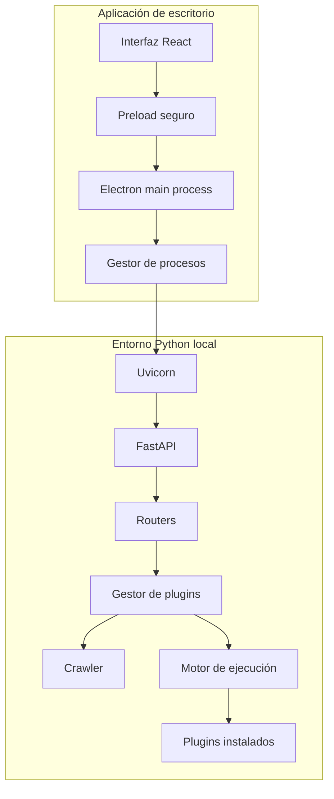

---

# 11. Gestión del ciclo de vida de FastAPI

Uno de los desafíos técnicos del cliente consiste en administrar FastAPI como un proceso local.

La aplicación debe poder iniciar, detener y reiniciar el backend sin dejar procesos huérfanos.

## 11.1. Responsabilidades del gestor de procesos

- Iniciar Uvicorn.
- Utilizar el entorno Python correcto.
- Detectar errores de arranque.
- Capturar logs.
- Verificar disponibilidad.
- Solicitar una detención controlada.
- Finalizar el proceso cuando corresponda.
- Reiniciar el servidor.
- Evitar instancias duplicadas.
- Gestionar el cierre de Electron.

## 11.2. ¿Por qué no depender de un endpoint HTTP para apagar FastAPI?

El gestor de procesos de Electron puede controlar el proceso que inició.

Esto evita exponer innecesariamente una operación de apagado mediante una API HTTP local.

El mecanismo debe considerar que el proceso puede tener procesos hijos y que una terminación forzada puede impedir la limpieza de recursos.

## 11.3. Flujo de ciclo de vida

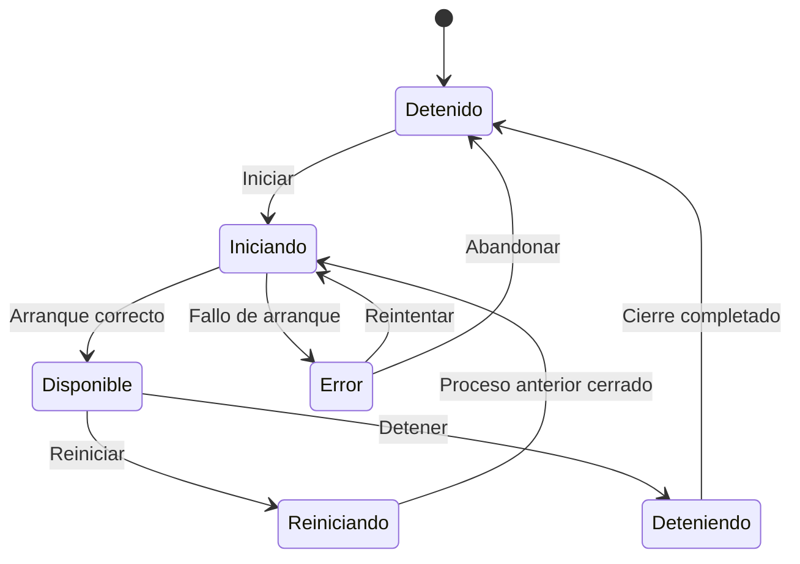

## 11.4. Consideraciones de seguridad local

FastAPI no debe considerarse seguro simplemente por ejecutarse en el computador del usuario.

Se recomienda:

- Escuchar únicamente en interfaces necesarias.
- Evitar exponer el backend a la red local si no se necesita.
- Validar todas las entradas.
- Proteger las operaciones administrativas.
- Restringir el acceso desde el navegador.
- Controlar CORS y los encabezados relevantes.
- No confiar en datos enviados por la interfaz.
- Evitar exponer secretos mediante logs.
- Proteger las comunicaciones entre Electron y FastAPI.

---

# 12. Empaquetado de Electron y Python

El cliente necesita distribuirse como aplicación instalable.

El desafío consiste en incluir las dependencias necesarias sin impedir la actualización de los plugins.

## 12.1. Componentes que deben distinguirse

1. Aplicación Electron.
2. Archivos del frontend.
3. Runtime de Python.
4. Dependencias Python.
5. Backend FastAPI.
6. Plugins instalados.
7. Configuración local.
8. Datos persistentes.

## 12.2. Estrategia conceptual

La aplicación principal debería poder actualizarse independientemente de los plugins cuando sea posible.

Los plugins pueden instalarse en un directorio administrado y separado del código empaquetado.

Esto reduce la necesidad de reconstruir todo el instalador cada vez que cambia una automatización.

## 12.3. Riesgos

- Dependencias Python ausentes.
- Rutas incorrectas después del empaquetado.
- Plugins ubicados en directorios de solo lectura.
- Incompatibilidades entre versiones.
- Antivirus que bloquean ejecutables.
- Errores con extensiones nativas.
- Diferencias entre desarrollo y producción.
- Archivos de configuración no incluidos.
- Instalaciones incompletas.

## 12.4. PyInstaller

PyInstaller puede utilizarse para empaquetar el backend Python, pero requiere comprobar cómo se resolverán los módulos y dependencias de los plugins.

Un plugin instalado después de crear el ejecutable puede no estar disponible mediante los mecanismos normales de importación si el empaquetado asume que todos los módulos están incluidos de antemano.

Por eso, es necesario diseñar explícitamente cómo se cargan los plugins externos.

No debe asumirse que PyInstaller descubrirá automáticamente cualquier módulo Python instalado posteriormente.

---

# 13. Flujo completo de instalación y actualización

El objetivo es mantener sincronizados los plugins publicados y los instalados localmente.

## 13.1. Flujo previsto

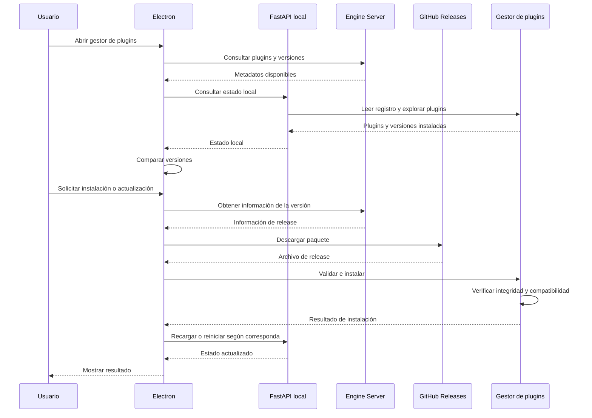

Este diagrama es una propuesta del flujo de extremo a extremo. Los mecanismos exactos de comunicación y quién realiza cada descarga dependen de la implementación final.

## 13.2. Validaciones recomendadas

Antes de instalar una actualización:

- Verificar la identidad del plugin.
- Comprobar la versión.
- Verificar la integridad del paquete.
- Validar la compatibilidad con el motor.
- Evitar rutas de extracción inseguras.
- Evitar sobrescribir archivos ajenos al plugin.
- Crear una copia recuperable de la versión anterior.
- Confirmar que la instalación terminó correctamente.
- Mantener logs del resultado.

## 13.3. Recuperación ante errores

Una actualización robusta debería evitar dejar el plugin en un estado parcialmente instalado.

El procedimiento puede consistir en:

1. Descargar el paquete a una ubicación temporal.
2. Validar su integridad.
3. Comprobar su estructura.
4. Preparar la instalación.
5. Sustituir la versión anterior de forma controlada.
6. Verificar el resultado.
7. Recuperar la versión anterior si falla la operación.

---

# 14. Ejecución de automatizaciones

El cliente local permite ejecutar las funciones de los plugins.

El proceso debería seguir un contrato definido para entradas, salidas y errores.

## 14.1. Ciclo de ejecución

1. Seleccionar el plugin.
2. Identificar la operación solicitada.
3. Validar los parámetros.
4. Comprobar las autorizaciones requeridas.
5. Preparar el contexto de ejecución.
6. Invocar la función correspondiente.
7. Capturar logs y errores.
8. Guardar el resultado cuando corresponda.
9. Informar el estado al usuario.

## 14.2. Estados posibles

Una ejecución puede utilizar estados como:

- Pendiente.
- Preparando.
- En ejecución.
- Completada.
- Fallida.
- Cancelada.

Estos estados son una propuesta de modelado y no implican que exista actualmente un registro persistente de todas las ejecuciones.

## 14.3. Registro de ejecuciones

Para proporcionar trazabilidad, el sistema puede registrar:

- Identificador de ejecución.
- Plugin utilizado.
- Versión.
- Usuario solicitante.
- Organización.
- Fecha de inicio.
- Fecha de término.
- Estado.
- Resumen del resultado.
- Referencia a los logs.

Los datos sensibles no deberían guardarse innecesariamente en los logs.

---

# 15. Funciones Python representadas mediante JSON

Una evolución posible de Octomation consiste en representar las funciones disponibles mediante metadatos estructurados.

Esto permitiría construir una interfaz gráfica para conectar funciones sin que el usuario tenga que escribir manualmente todo el código de orquestación.

## 15.1. Separación conceptual

Es importante distinguir tres elementos:

1. La implementación real de una función en Python.
2. Los metadatos que describen cómo utilizarla.
3. La definición del flujo que conecta varias funciones.

El JSON describe la función y el flujo. No convierte automáticamente el código Python en datos ejecutables.

## 15.2. Ejemplo conceptual de catálogo

```json
{
  "functions": [
    {
      "id": "csv.read",
      "name": "Leer CSV",
      "inputs": [
        {
          "name": "path",
          "type": "string",
          "required": true
        }
      ],
      "outputs": [
        {
          "name": "data",
          "type": "dataset"
        }
      ]
    },
    {
      "id": "dataset.filter",
      "name": "Filtrar registros",
      "inputs": [
        {
          "name": "data",
          "type": "dataset",
          "required": true
        },
        {
          "name": "condition",
          "type": "object",
          "required": true
        }
      ],
      "outputs": [
        {
          "name": "filtered_data",
          "type": "dataset"
        }
      ]
    }
  ]
}
```

Este ejemplo es ilustrativo. La sintaxis real debe definirse mediante un contrato formal.

## 15.3. Mapa mental del editor visual

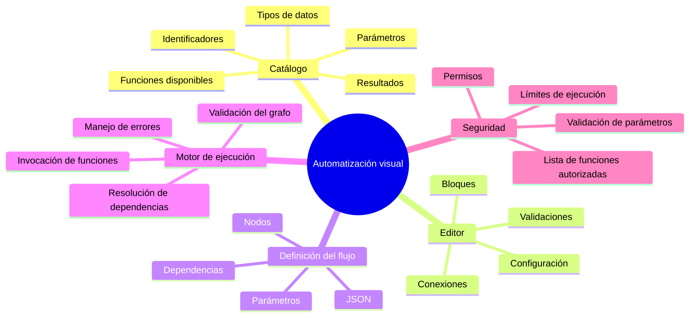

## 15.4. Ejecución del flujo

El motor debería interpretar la definición del flujo, validar las dependencias y llamar únicamente a las funciones registradas.

No es recomendable ejecutar código arbitrario recibido desde un archivo JSON mediante `eval` o mecanismos equivalentes.

---

# 16. Seguridad de la plataforma

La seguridad debe aplicarse tanto en la infraestructura remota como en el computador local.

## 16.1. Seguridad remota

- Validación de JWT.
- Control de expiración.
- Autorización por operación.
- Validación de pertenencia al tenant.
- Protección de endpoints.
- Validación de parámetros.
- Protección de secretos.
- Auditoría de operaciones relevantes.
- Gestión segura de credenciales.

## 16.2. Seguridad local

- Restricción de acceso a FastAPI.
- Validación de solicitudes.
- Protección del almacenamiento de tokens.
- Control de acceso a archivos.
- Gestión segura de procesos.
- Validación de plugins.
- Restricción de operaciones administrativas.
- Protección de logs.
- Manejo de credenciales de terceros.

## 16.3. Seguridad de plugins

Los plugins pueden ejecutar código Python con los permisos del proceso que los ejecuta.

Por ello, una firma válida o una estructura correcta no demuestra por sí sola que un plugin sea seguro.

Se recomienda:

- Utilizar fuentes de distribución controladas.
- Verificar la integridad de los paquetes.
- Aplicar revisiones de código.
- Definir permisos y capacidades.
- Limitar accesos innecesarios.
- Controlar las dependencias.
- Evitar ejecutar plugins desconocidos automáticamente.
- Considerar aislamiento de procesos para plugins no confiables.

## 16.4. Mapa mental de seguridad

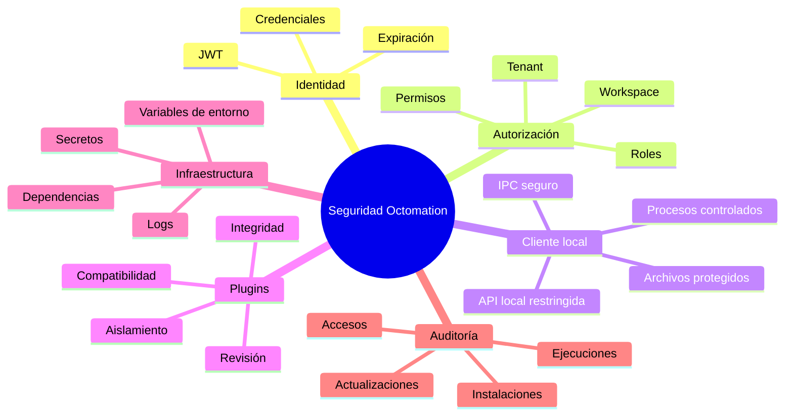

---

# 17. Bases de datos y persistencia

El proyecto utiliza PostgreSQL para persistir información de los servicios backend.

En el entorno local se ha trabajado con Docker y un contenedor denominado `plataforma_db`.

El puerto de desarrollo utilizado es `5433`.

## 17.1. Bases de datos contempladas

| Base de datos | Dominio |
|---|---|
| `iam_db` | Identidad y acceso |
| `tenant_db` | Organizaciones y workspaces |
| `billing_db` | Facturación y suscripciones |
| `transactions_db` | Transacciones y pagos |

La distribución lógica de los datos debe verificarse en los esquemas de cada servicio.

## 17.2. Drizzle ORM

Drizzle se utiliza en el ecosistema TypeScript para definir esquemas y realizar consultas tipadas.

Entre sus ventajas están:

- Tipado estático.
- Consultas explícitas.
- Integración con TypeScript.
- Definición de esquemas.
- Gestión de migraciones.

## 17.3. Docker

Docker permite levantar PostgreSQL de forma reproducible en el entorno de desarrollo.

Una distinción importante es que los scripts de inicialización, como `init.sql`, normalmente se ejecutan cuando se crea un directorio de datos vacío.

Modificar `init.sql` y reiniciar un contenedor existente no implica que PostgreSQL vuelva a ejecutar automáticamente todos los comandos de inicialización.

Para cambios posteriores se deben utilizar migraciones o ejecutar los cambios correspondientes sobre la base de datos existente.

Eliminar el volumen de datos puede borrar información persistente, por lo que no debe hacerse sin comprobar primero qué contiene.

## 17.4. Arquitectura de persistencia

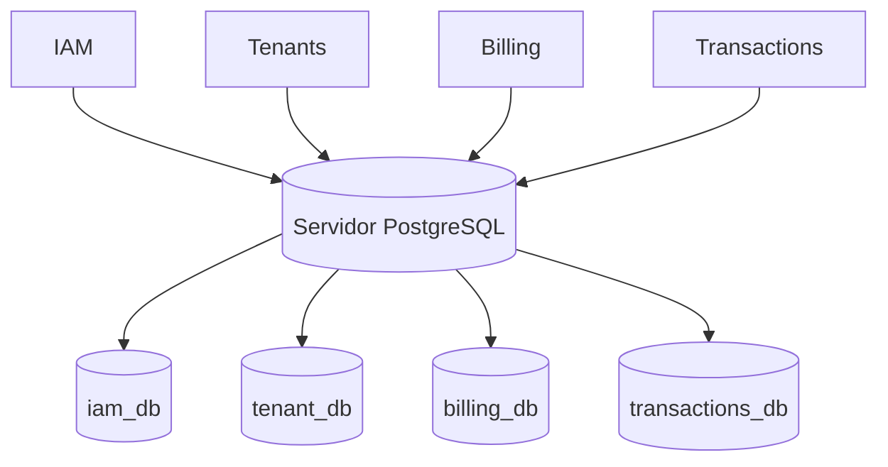

En el entorno descrito, las bases pueden compartir una misma instancia PostgreSQL. Esto constituye una separación lógica de bases de datos, no necesariamente un despliegue físico independiente de cada servicio.

---

# 18. Repositorios y Git submodules

El proyecto utiliza repositorios separados para organizar los distintos servicios y componentes.

El repositorio raíz mencionado es:

`DQAphex/CAPSTONE---OCTOMATION`

También se ha trabajado con repositorios como:

- `DQAphex/TenantsMicroservice`
- `DQAphex/OCTO-TRANSACTIONS`
- `Octomation-Engine-Server`
- `Octomation-Engine-Client`

La estructura efectiva debe verificarse mediante `.gitmodules`.

## 18.1. ¿Por qué utilizar submódulos?

Los submódulos permiten integrar repositorios independientes dentro de un proyecto principal.

Cada submódulo conserva su propio historial y el repositorio raíz registra un commit específico de ese repositorio.

Esto facilita la separación de responsabilidades, pero exige administrar correctamente las referencias de versiones.

## 18.2. Clonar el proyecto

Para clonar el repositorio y obtener sus submódulos:

```bash
git clone --recurse-submodules <URL_DEL_REPOSITORIO>
```

Si el repositorio ya fue clonado:

```bash
git submodule update --init --recursive
```

## 18.3. Actualizar un submódulo

Primero se entra al repositorio correspondiente y se obtiene el estado remoto.

```bash
git -C <RUTA_DEL_SUBMODULO> fetch origin
git -C <RUTA_DEL_SUBMODULO> status
```

Después se revisan los commits y se decide qué versión integrar.

Cuando se actualiza el commit del submódulo, el repositorio raíz debe registrar el nuevo puntero mediante un commit propio.

## 18.4. Mapa mental de repositorios

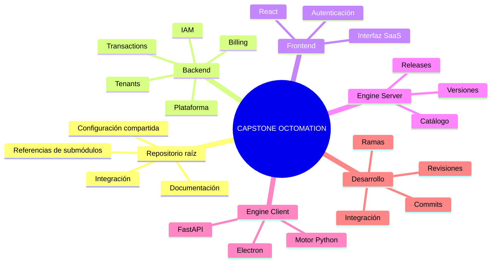

---

# 19. CI/CD e integración continua

CI/CD busca automatizar la validación, construcción y entrega del software.

En una arquitectura con múltiples repositorios, permite comprobar que cada servicio puede construirse y probarse de forma independiente.

## 19.1. Objetivos

- Detectar errores tempranamente.
- Ejecutar pruebas automatizadas.
- Validar compilaciones.
- Comprobar dependencias.
- Construir artefactos.
- Publicar versiones.
- Facilitar la integración de submódulos.

## 19.2. Pipeline conceptual

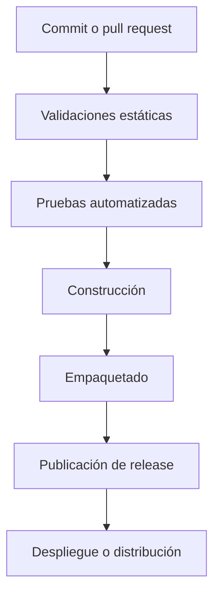

El pipeline real puede tener etapas diferentes según el servicio.

La existencia de un pipeline no implica que todos los pasos estén implementados en cada repositorio.

---

# 20. Organización de los componentes del proyecto

La siguiente tabla resume los principales elementos conocidos y su propósito.

| Componente | Responsabilidad principal |
|---|---|
| Frontend React | Interfaz web de la plataforma |
| Plataforma backend | Funcionalidades centrales del SaaS |
| IAM | Autenticación y autorización |
| Tenants | Organizaciones y workspaces |
| Billing | Planes y facturación |
| Transactions | Transacciones e intentos de pago |
| Engine Server | Información y distribución de plugins |
| Engine Client | Aplicación de escritorio |
| Electron | Interfaz y control de procesos |
| FastAPI | API local del motor |
| Crawler | Descubrimiento de plugins |
| Plugin Manager | Administración del ciclo de vida de plugins |
| Motor Python | Ejecución de automatizaciones |
| PostgreSQL | Persistencia de datos |
| Docker | Infraestructura local |
| Git submodules | Integración de repositorios |
| CI/CD | Validación y entrega del software |

---

# 21. Estado del proyecto y próximos pasos

Este resumen se basa en los avances descritos hasta el 29 de octubre de 2026. No constituye una verificación automática de los repositorios actuales.

## 21.1. Componentes trabajados

- Arquitectura general de la plataforma.
- Servicios backend con NestJS.
- Autenticación mediante JWT.
- Modelado de tenants y workspaces.
- Bases de datos PostgreSQL.
- Docker para desarrollo.
- Integración de repositorios mediante submódulos.
- Cliente de escritorio Electron.
- Backend local FastAPI.
- Generador de plantillas de plugins.
- Crawler para descubrir plugins.
- Descarga de releases de GitHub.
- Gestión de versiones de plugins.
- Empaquetado de la aplicación.

## 21.2. Puntos técnicos que requieren verificación

- Arranque estable de FastAPI desde la aplicación empaquetada.
- Gestión completa de procesos y cierre de la aplicación.
- Comunicación segura entre Electron y FastAPI.
- Integración del login con el cliente de escritorio.
- Validación de permisos para operaciones sensibles.
- Aislamiento efectivo de datos entre tenants.
- Instalación y actualización completa de plugins.
- Recuperación ante instalaciones fallidas.
- Compatibilidad entre versiones del motor y plugins.
- Integración de los servicios comerciales.
- Registro y seguimiento de ejecuciones.
- Pruebas automatizadas de extremo a extremo.

## 21.3. Orden sugerido de prioridades

1. Estabilizar el arranque y cierre del backend local.
2. Definir el contrato entre Electron y FastAPI.
3. Integrar la autenticación del cliente.
4. Validar la autorización en los endpoints protegidos.
5. Completar el descubrimiento e instalación de plugins.
6. Implementar actualizaciones recuperables.
7. Definir contratos de ejecución de plugins.
8. Añadir logs y estados de ejecución.
9. Automatizar pruebas de integración.
10. Avanzar hacia la interfaz visual de automatizaciones.

---

# 22. Visión de evolución del producto

La visión de Octomation es pasar de un sistema capaz de administrar plugins a una plataforma en la que los usuarios puedan construir y ejecutar flujos de trabajo.

## 22.1. Posibles capacidades futuras

- Catálogo central de automatizaciones.
- Editor visual de flujos.
- Conexión de funciones mediante bloques.
- Validación de tipos de datos.
- Programación de ejecuciones.
- Historial de resultados.
- Observabilidad centralizada.
- Administración de permisos por automatización.
- Gestión de credenciales.
- Distribución controlada de plugins.
- Métricas de uso.
- Límites comerciales por plan.

Estas capacidades representan una dirección de evolución, no funcionalidades que deban considerarse terminadas.

## 22.2. Mapa mental de evolución

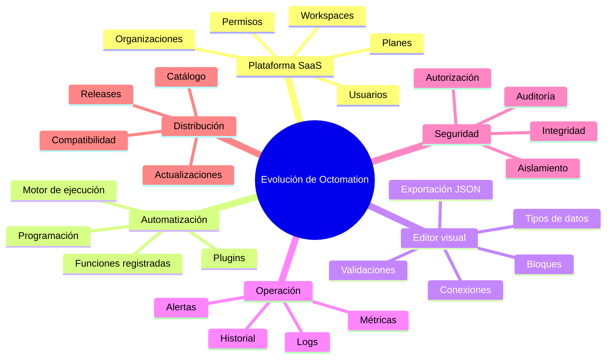

---

# 23. Glosario técnico

| Término | Explicación |
|---|---|
| SaaS | Software ofrecido como servicio |
| API | Interfaz que permite la comunicación entre componentes |
| Microservicio | Servicio con responsabilidades delimitadas |
| IAM | Gestión de identidad y acceso |
| JWT | Formato de token para transportar claims |
| Tenant | Contexto organizacional aislado |
| Workspace | Espacio de trabajo |
| Plugin | Componente que incorpora una funcionalidad |
| Crawler | Componente que examina el entorno para descubrir elementos |
| Release | Versión publicada de un proyecto |
| Electron | Framework para crear aplicaciones de escritorio |
| FastAPI | Framework Python para construir APIs |
| Uvicorn | Servidor ASGI utilizado para ejecutar aplicaciones Python |
| Drizzle ORM | Herramienta de acceso a bases de datos para TypeScript |
| PostgreSQL | Sistema gestor de bases de datos relacional |
| Docker | Plataforma de contenedores |
| Git submodule | Referencia a un repositorio Git dentro de otro repositorio |
| CI/CD | Prácticas y procesos de integración y entrega continuas |
| IPC | Comunicación entre procesos |
| DTO | Objeto utilizado para transportar y validar datos |
| Observabilidad | Capacidad de comprender el comportamiento del sistema mediante logs, métricas y trazas |

---

# 24. Explicación para una presentación oral

Octomation es una plataforma de automatización empresarial que busca centralizar la administración de procesos automatizados y facilitar su distribución mediante plugins.

La arquitectura está dividida en una plataforma web, servicios backend y un cliente de escritorio. Los servicios backend administran la identidad, las organizaciones, los permisos y las funcionalidades comerciales. Por su parte, el cliente utiliza Electron y FastAPI para proporcionar un entorno local donde se ejecutan los plugins desarrollados en Python.

El sistema de plugins permite incorporar funcionalidades independientes y administrar sus versiones mediante un mecanismo de distribución basado en releases. Esto busca reducir la necesidad de instalar y mantener manualmente cada automatización.

Desde el punto de vista arquitectónico, el desafío principal consiste en integrar correctamente la autenticación, la autorización, el aislamiento multiempresa, la distribución de plugins y la ejecución local.

La visión futura es permitir que usuarios no técnicos puedan construir automatizaciones conectando visualmente funciones predefinidas, mientras el motor local se encarga de ejecutarlas de forma controlada.

---

# 25. Definición final del proyecto

**Octomation es una plataforma modular de automatización empresarial que combina administración centralizada, servicios multiempresa y ejecución local mediante plugins, con una arquitectura preparada para evolucionar hacia la creación visual de flujos de trabajo.**

Su principal valor arquitectónico consiste en separar la administración de la plataforma, la lógica de negocio de sus servicios, la distribución de funcionalidades y la ejecución local de las automatizaciones.

El proyecto no consiste solamente en desarrollar scripts: busca construir la infraestructura necesaria para administrar, distribuir, actualizar y ejecutar automatizaciones de manera consistente y extensible.
